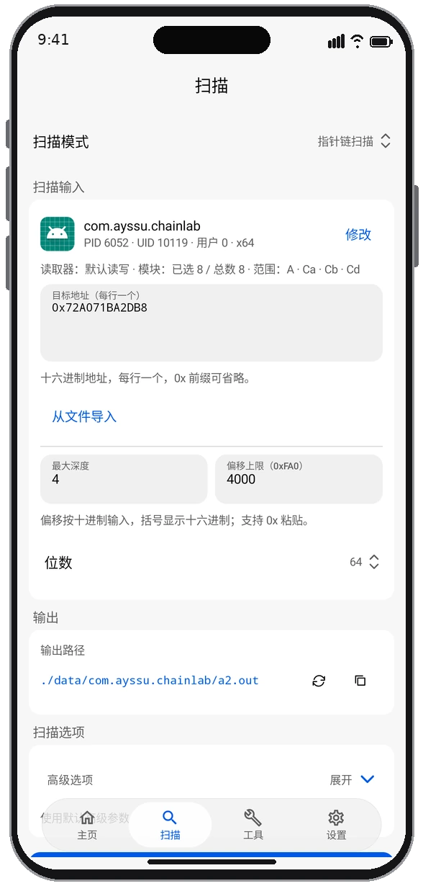
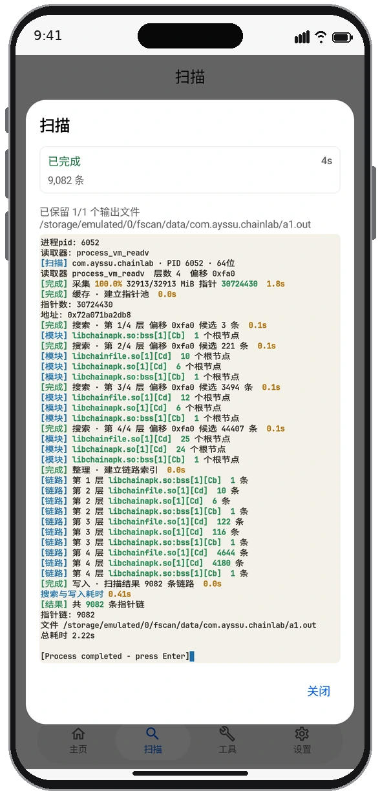
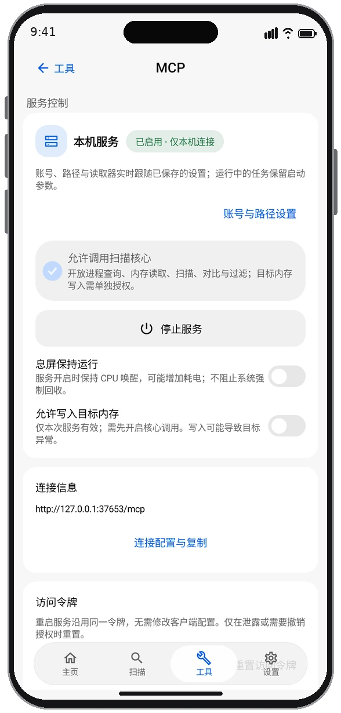

<p align="center">
  
</p>

<h1 align="center">FastScan Next V3</h1>
<p align="center"><strong>从定位地址，到验证稳定的指针链</strong></p>
<p align="center">指针扫描 · 对比过滤 · 链路调试 · 悬浮操作 · MCP 服务</p>

<p align="center">
  <a href="https://github.com/AYssu/fast-scan/releases/latest"></a>
  
  
</p>

<p align="center">
  <a href="https://github.com/AYssu/fast-scan/releases/latest">下载安装</a> ·
  <a href="#界面预览">界面预览</a> ·
  <a href="FastScan-Next-使用手册.md">使用手册</a> ·
  <a href="releases/">版本更新</a> ·
  <a href="https://github.com/AYssu/fast-scan/issues">反馈问题</a>
</p>


FastScan 是面向 Android 的指针链扫描与验证工具。选择目标进程、读取器和内存范围，围绕当前地址扫描链路；通过多次对比、过滤和逐级调试，检查链条是否仍然有效。

原生界面负责配置和结果操作，终端显示任务进度。需要在其他应用上操作时，可以使用悬浮窗与悬浮球；也可以连接 MCP 客户端协助执行查询与分析。

这个仓库提供安装包、使用文档、指针测试工具及配套模板，不是完整 Android 应用与扫描核心的源码仓库。

> 当前正式版：**3.0.8**。安装包、完整配套文件及更新内容请前往 Releases 下载查看。

<br clear="right" />

## 下载安装

前往 [Releases](https://github.com/AYssu/fast-scan/releases) 下载。以下是 3.0.8 的配套文件安排：

| 文件 | 适合谁 | 包含什么 |
| --- | --- | --- |
| **FastScan-Next-V3.0.8.zip** | 首次使用，或需要配套工具 | FastScan APK、Pointer Chain Test、离线手册、可选驱动、libfs C++ 与 Lua 模板。 |
| **FastScan-V3.0.8.apk** | 只需要安装或升级应用 | Android 安装包，支持 ARM64 与 x86_64。 |
| **FastScan-Next-Manual.md** | 希望离线查阅操作 | 使用流程、参数说明、MCP 连接与常见问题。 |
| **SHA256SUMS** | 需要核对下载完整性 | 对应发布附件的 SHA-256 校验值。 |

- **ARM64 / arm64-v8a**：大多数 Android 手机。
- **x86_64**：对应架构的设备与 Android 模拟器。
- 最低安装要求为 **Android 7.0 / API 24**，不代表所有厂商系统与读取器均已验证。

GitHub 自动生成的 **Source code** 压缩包是本仓库快照。日常安装请选择发布附件中的 APK 或完整包；驱动按需使用，无需复制进 APK。

## 界面预览

<table>
  <tr>
    <td align="center"></td>
    <td align="center"></td>
    <td align="center"></td>
  </tr>
  <tr>
    <td align="center">扫描配置</td>
    <td align="center">扫描输出</td>
    <td align="center">MCP 服务</td>
  </tr>
</table>

## 你可以做什么

| 场景 | 功能 |
| --- | --- |
| **查找指针链** | 设置目标地址、层数与最大偏移，按内存范围采集、按模块筛选根节点；支持从文件导入地址。 |
| **筛选稳定结果** | 对比多次扫描结果，再按当前地址过滤；匹配上限可配置，对比与过滤默认 3000 万条。 |
| **核对链条** | 查看逐级跳转、最终地址和读取值，复制链路继续验证；支持为 start 链设置起始地址。 |
| **整理结果文件** | 转换 OUT、TXT 等结果格式，便于后续对比、查看与调试。 |
| **选择界面外观** | 设置中可选跟随系统、深色或浅色，自动保存，主窗口与悬浮窗同步。 |
| **切换目标与读取器** | 在“进程与模块”集中选择进程、读取器、内存范围和模块，并运行读取器测试。 |
| **在其他应用上操作** | 从首页开启悬浮窗，用悬浮球收起与展开；支持移动、右下角缩放及横竖屏操作。 |
| **查看系统公告** | 主页右上角通知铃铛打开公告，默认红点，可勾选三天不提醒；主页竖排查看最近任务。 |
| **观察长任务** | 在终端查看彩色阶段、进度与耗时，结束后检查结果数量和文件状态；短任务可能直接完成。 |
| **连接 MCP 客户端** | 共享当前目标和配置，执行扫描、对比、过滤、链路跟踪及受限内存读写。 |

## 开始使用

1. **配置账号与权限**：在「设置 → 账号与服务」填写自己的账号密码，点击「登录并查询授权」保存；在「路径与存储」检查数据目录及所需权限。
2. **选择目标**：进入“进程与模块”，确认目标进程、读取器、内存范围和扫描模块，先运行“测试读取器”。
3. **完成一次扫描**：填写当前有效的目标地址，建议先以 **4 层 / 最大偏移 2048** 验证流程，再按需扩大范围。
4. **重新定位并对比**：重启目标应用后获取新地址，再次扫描，通过对比筛选稳定链。
5. **过滤与调试**：按当前地址过滤结果，逐级检查链路；停止或异常结束后，确认输出文件是否完整再继续使用。

默认数据目录为 `/storage/emulated/0/fscan/data/`。目标进程重启后，PID 和绝对地址可能变化，应重新确认目标；保存的选择不代表旧地址仍然有效。

完整操作见[使用手册](FastScan-Next-使用手册.md)，安装和权限提醒见[注意事项](注意事项.txt)。

## 配套测试与集成

### Pointer Chain Test 1.9

[测试软件](测试软件/)中提供 `Pointer-Chain-Test-1.9.apk`，包名 `com.ayssu.chainlab`，用于自行验证进程选择、扫描与读取。

- **两种模块加载方式**：APK 内直接加载与独立 SO 文件加载，每组包含 1～4 级 JNI 链条。
- **主进程与服务子进程**：可切换查看对应 PID 和链条，测试子进程扫描；点击只改变当前所选进程的整数值。
- **方便取址**：整数随机范围 1～999，长按复制地址、值或 Cd 链路；同一构建下模块相对路径固定，绝对地址可随进程重启改变。
- **大规模采集场景**：主进程默认建立 32 GiB 稀疏虚拟空间及约 3000 万条背景指针引用，设置不可读页面；服务子进程使用轻量链条。

32 GiB 是虚拟地址空间，背景对象实际约占用 **464 MiB**，另有应用自身开销。低内存设备请先关闭其他高负载任务；无需 Root 即可运行测试工具，跨应用扫描仍需相应读取权限。

### libfs 静态库与模板

[C++ 模板](动态基址模板/cpp模板/README.md)使用 **libfs 0.1.0**，提供 Android `arm64-v8a` 与 `x86_64` 的 `libfs.a`、C / C++ 头文件及模块查询、整数读取示例。两架构示例已通过 NDK 构建与链接验证。

每个实例独立持有目标 PID 和读取器，可使用内置读写方式，也能接入自己的驱动实例或字节数回调。最低 API 24，使用 C++17；具体约定见 [libfs 使用说明](动态基址模板/cpp模板/libfs-使用说明.md)。

当前模板已移除 libSea3 与旧 smemory 接口。libfs 只提供模块和内存读写，不解析 OUT / NORM 文件，也不自动请求 Root；链条需由调用方按实际偏移逐级解引用。[Lua 模板](动态基址模板/lua模板/)沿用既有示例，使用前核对链路格式。

## 通过 MCP 协助操作

MCP 已内置在应用中，无需另装服务程序。进入「工具 → MCP 服务」，确认所需配置后启动。

<details>
<summary>展开电脑连接示例</summary>

使用 ADB 转发手机服务端口：

```bash
adb -s DEVICE_SERIAL forward tcp:47653 tcp:37653
```

在支持 Streamable HTTP 的客户端中填写：

```text
地址：http://127.0.0.1:47653/mcp
请求头：Authorization: Bearer <手机页面显示的访问令牌>
```

服务默认只监听手机本机，转发断开后需重新建立连接。访问令牌不是 FastScan 账号密码，不要公开。

内存写入默认关闭，需要在手机端单独授权，客户端不能自行开启。连接方式、工具与权限边界见手册中的 MCP 服务章节。

</details>

## 使用范围与配套文件

- **进程访问**：跨进程读取取决于 Root、读取器及系统权限；普通模式不会绕过 Android 的访问限制。
- **可选驱动**：[内核驱动](内核驱动/)包含 KPM、RT 配套文件，适配情况取决于设备内核和加载环境，不保证全机型可用。
- **后台任务**：收起悬浮窗或切后台不会主动停止任务；系统结束应用后不保证任务继续执行，也不会自动恢复原任务。文件存在不代表结果完整。
- **终端入口**：隐藏模式改变终端访问入口，底层仍使用 PTY，不保证规避检测。
- **版本文件**：当前目录只保留最新配套 APK，历史安装包从对应 Releases 获取；历史更新说明保留在[版本更新](releases/)中。

```text
fast-scan/
├── 扫描软件/                  FastScan 3.0.8
├── 测试软件/                  Pointer Chain Test 1.9
├── 动态基址模板/
│   ├── cpp模板/               libfs.a、头文件与 C++ 示例
│   └── lua模板/               Lua 链路示例
├── 内核驱动/                  可选配套驱动
├── FastScan-Next-使用手册.md   完整操作说明
└── releases/                  版本日志与分发清单
```

## 问题反馈

可以在 [Issues](https://github.com/AYssu/fast-scan/issues) 或 QQ 群 **903485530** 反馈。请提供应用版本、设备型号、Android 版本、读取器、复现步骤及必要截图或日志；链路问题尽量附上对应参数与一条可核对的链路。

分享前请隐去账号、密码和 MCP 访问令牌。只在已获授权的设备和应用上使用，并在操作前保存重要数据。
